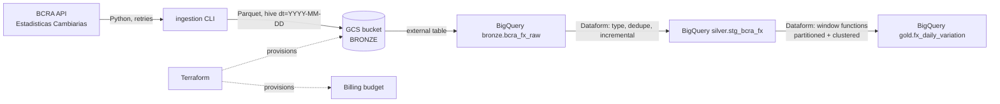

# Data-Lakehouse

A small GCP data lakehouse built on Argentine open data: daily exchange rates published by the
Central Bank of Argentina (BCRA). It demonstrates a bronze / silver / gold (medallion) layout
with Terraform, Python ingestion, BigQuery and Dataform.

**Stack:** GCP (GCS, BigQuery, Dataform), Terraform, Python 3.11, SQL, GitHub Actions.

## Architecture



| Layer  | Where                         | Content                                         |
|--------|-------------------------------|-------------------------------------------------|
| Bronze | GCS Parquet + external table  | Raw rates as ingested, one folder per day       |
| Silver | `silver.stg_bcra_fx`          | Typed, deduplicated, incremental (merge by key) |
| Gold   | `gold.fx_daily_variation`     | Daily rate + day-over-day change, partitioned by date, clustered by currency |

## Design notes

- **Region:** `southamerica-east1` (Sao Paulo), closest to Argentina. Bucket and datasets must share a location for external tables.
- **Idempotent ingestion:** each day writes to a fixed path (`dt=.../data.parquet`), so re-running overwrites instead of duplicating. Silver also dedupes by latest `ingested_at`.
- **BCRA API quirks (verified):**
  - Endpoint: `GET /estadisticascambiarias/v1.0/Cotizaciones?fecha=YYYY-MM-DD`; response is `results.fecha` plus `results.detalle[]` with `codigoMoneda`, `descripcion`, `tipoPase`, `tipoCotizacion`.
  - Requests with the default Python `User-Agent` got HTTP 403; a custom `User-Agent` works.
  - Weekends/holidays return `fecha: null` and an empty `detalle` (HTTP 200), so they produce no partition.
  - TLS: the host has had incomplete certificate chain issues. Verification is on by default; `--insecure-skip-tls-verify` is an explicit, logged opt-in. Prefer `REQUESTS_CA_BUNDLE` with the proper intermediate certificate.

## Setup (in order)

1. **GCP project and budget first.** Create a project, link a billing account, and authenticate:
   `gcloud auth login && gcloud auth application-default login`.
2. **Terraform.**
   ```bash
   cd terraform
   cp terraform.tfvars.example terraform.tfvars   # fill project_id and billing_account_id
   terraform init && terraform plan && terraform apply
   ```
   This creates the bronze bucket, the three datasets, an ingestion service account and a budget with alerts at 50/90/100%.
3. **Ingestion.**
   ```bash
   make install
   make ingest-dry START=2025-09-01 END=2025-09-30                  # local Parquet only
   make ingest PROJECT=<project> START=2025-09-01 END=2025-09-30    # upload to bronze
   ```
4. **Dataform.** Create a Dataform repository in the BigQuery console (region `southamerica-east1`), point it at the `dataform/` folder, set `defaultProject` and `vars.bronze_bucket` in `workflow_settings.yaml`, and run all actions (assertions included).
5. **Benchmark.**
   ```bash
   python sql/benchmarks/benchmark.py --project <project> --dataset gold --setup
   ```
   Dry runs report bytes processed for a flat table vs a partitioned + clustered one.

## Metrics

Fill these after running the pipeline.

| Metric                                          | Value |
|-------------------------------------------------|-------|
| Days ingested / date range                      | TBD   |
| Rows in bronze / silver / gold                  | TBD   |
| Bytes scanned, flat table (1 month, 1 currency) | TBD   |
| Bytes scanned, partitioned + clustered          | TBD   |
| Reduction in bytes scanned                      | TBD   |
| Monthly cost (from billing report)              | TBD   |
| Dataform assertions passing                     | TBD   |

## Development

```bash
make lint   # terraform fmt check + ruff
make test   # pytest (no network, uses saved fixtures)
```

CI (`.github/workflows/ci.yml`) runs terraform fmt/validate, ruff and pytest on pull requests. There is no deploy job yet.

## Roadmap

- Streaming: Pub/Sub + Dataflow
- Governance and data quality: Dataplex
- BigLake / Iceberg managed tables instead of plain external tables
- Full CI/CD deploy (Terraform apply and Dataform release via GitHub Actions with Workload Identity Federation)
